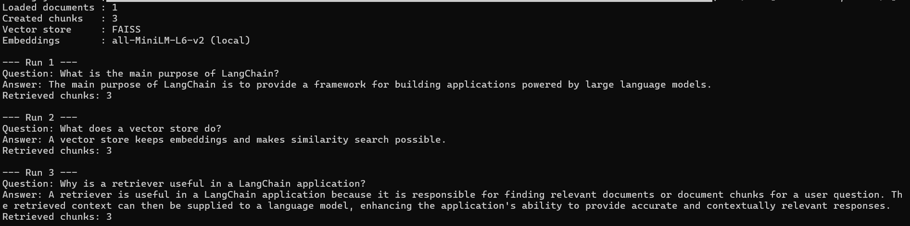
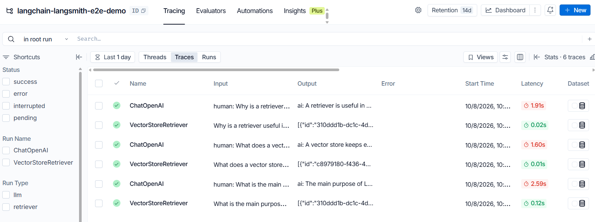
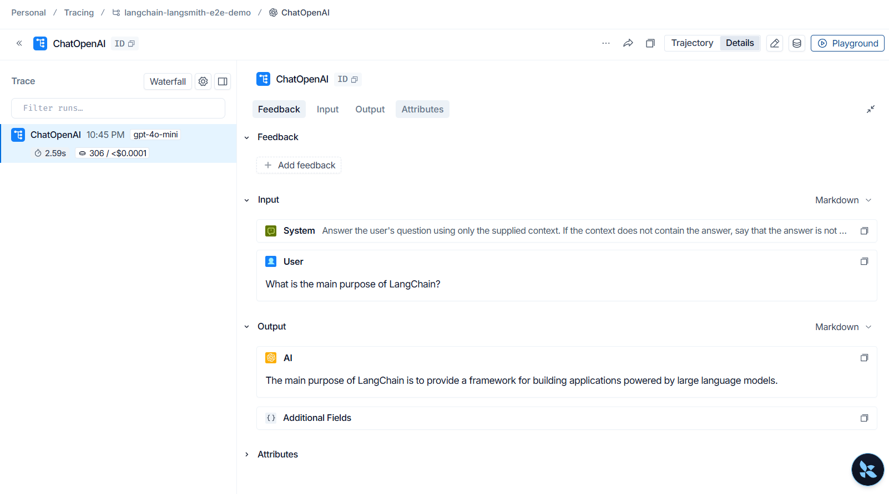

# LangChain Components + LangSmith

A compact end-to-end experiment exploring core LangChain components and LangSmith tracing.

## Overview

This project connects the main components of a LangChain application:

```text
sample.txt
   ↓
TextLoader
   ↓
RecursiveCharacterTextSplitter
   ↓
Hugging Face Embeddings
(all-MiniLM-L6-v2)
   ↓
FAISS Vector Store
   ↓
Retriever
   ↓
Prompt + Retrieved Context
   ↓
ChatOpenAI
   ↓
Answer
   ↓
LangSmith tracing
```

A local text document is loaded, split into chunks, embedded and stored in FAISS. Relevant chunks are retrieved and passed as context to an OpenAI chat model. LangSmith traces the execution through environment-based configuration.

## Objective

Understand how LangChain components work together in an end-to-end workflow and how LangSmith can be used to trace and inspect the execution.

## Components

### Data Ingestion

`TextLoader` loads `sample.txt` into LangChain `Document` objects.

### Text Splitting

`RecursiveCharacterTextSplitter` divides the document into smaller chunks for efficient retrieval.

### Embeddings

Uses `sentence-transformers/all-MiniLM-L6-v2` through the LangChain Hugging Face integration.

The model runs locally, so no paid embedding API is required.

### Vector Store

FAISS stores the document embeddings and provides similarity search.

### Retriever

The retriever searches FAISS and returns chunks relevant to a question.

### Chain

Retrieved context is combined with a prompt and passed to `ChatOpenAI` to generate the answer.

### LangSmith

LangSmith provides tracing and observability for the workflow, including:

- Input and prompt
- Retrieved context
- Model response
- Latency
- Token usage

## Why use a local embedding model?

`all-MiniLM-L6-v2` is lightweight and runs locally, keeping the embedding stage cost-free.

The OpenAI model is used only for generating the final response.

## Project Structure

```text
langchain-langsmith-e2e-demo/
│
├── traced_app.py
├── sample.txt
├── requirements.txt
├── .env.example
├── .gitignore
└── README.md
```

## Screenshots

### Application Output

The application successfully loads the document, builds the vector store, retrieves relevant content, and generates responses for the test questions.



### LangSmith Traces

LangSmith captures the individual retrieval and LLM operations generated during the application execution.



### LangSmith Run Details

An individual run can be inspected to view the input, output, and execution details.



## Setup

### 1. Create a virtual environment

Windows PowerShell:

```powershell
python -m venv .venv
.venv\Scripts\Activate.ps1
```

### 2. Install dependencies

```powershell
pip install -r requirements.txt
```

### 3. Configure environment variables

Create a `.env` file from `.env.example`:

```text
OPENAI_API_KEY=your-openai-api-key
OPENAI_MODEL=gpt-4o-mini

LANGSMITH_TRACING=true
LANGSMITH_API_KEY=your-langsmith-api-key
LANGSMITH_PROJECT=langchain-langsmith-e2e-demo
```

Replace the placeholder values with your API keys.

Do not commit `.env` to the repository.

### 4. Run the application

```powershell
python traced_app.py
```

The application will load and split the document, create local embeddings, build the FAISS vector store, retrieve relevant chunks, generate answers using OpenAI, and send the execution traces to LangSmith.

## Test Questions

The application runs three example questions:

```text
What is the main purpose of LangChain?

What does a vector store do?

Why is a retriever useful in a LangChain application?
```

## LangSmith Observability

After running the application, open the configured LangSmith project and inspect the generated runs.

A run can be used to examine the input, prompt, retrieved context, model output, latency, and token usage.

No LangSmith tracing code is required in the application; tracing is enabled through environment variables.

## Security

Never commit the real `.env` file or expose API keys in source control.

The repository includes `.env.example` as a configuration reference, while `.gitignore` excludes:

```text
.env
.venv/
__pycache__/
```

Before pushing, verify that no API keys or other secrets are included in tracked files.
